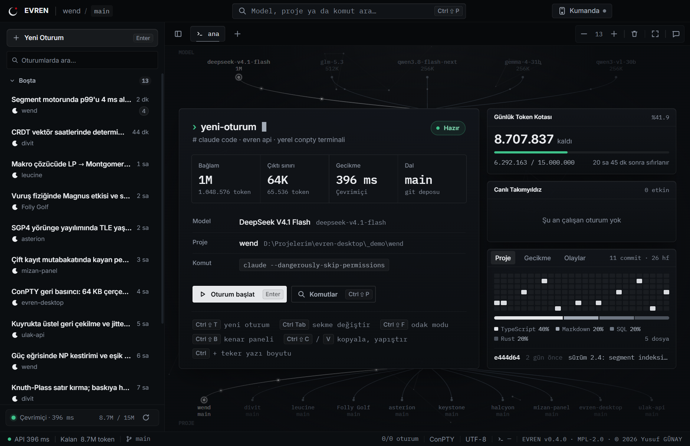
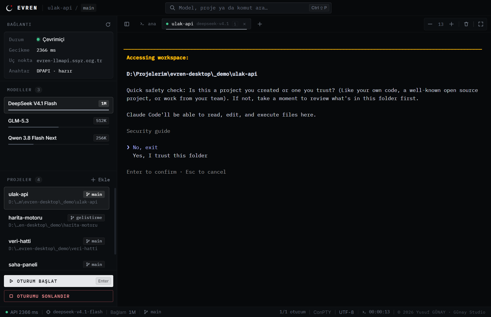
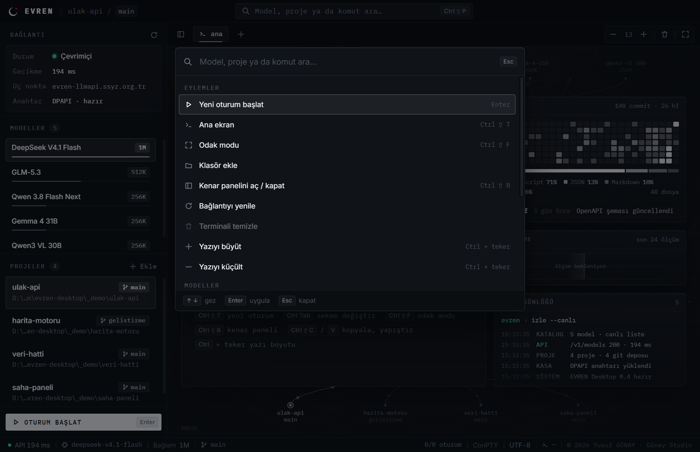
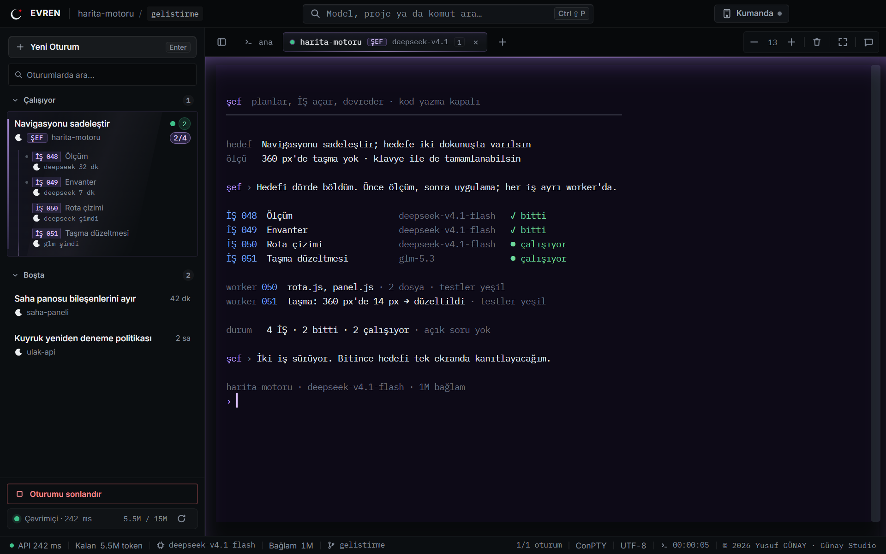
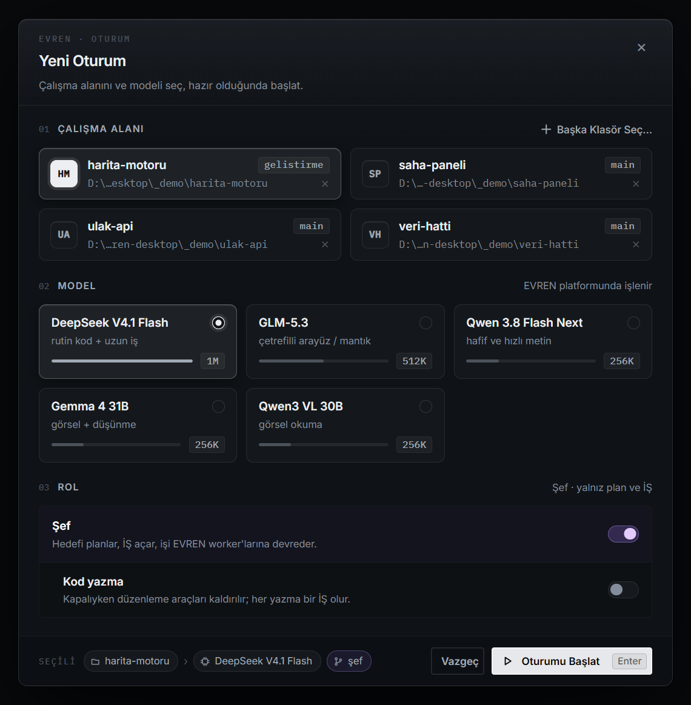
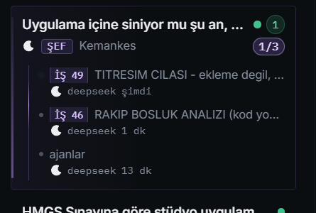
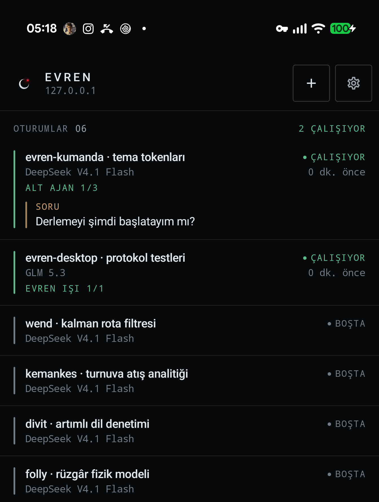
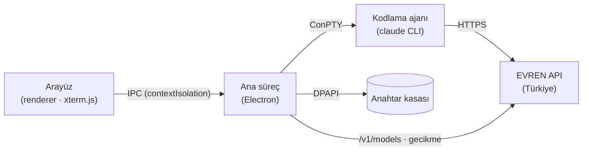

<p align="center">
  
</p>

<p align="center">
  <b>Yerli yapay zekâ altyapısında çalışan kodlama ajanı için masaüstü operasyon konsolu.</b><br />
  <sub>EVREN API · gerçek terminal · Windows</sub>
</p>

<p align="center">
  <a href="LICENSE"></a>
  
  
  
</p>

<p align="center">
  
</p>

---

## Nedir?

**EVREN Desktop**, [EVREN](https://evren.ssyz.org.tr) platformunun OpenAI/Anthropic uyumlu API'sini, terminalde çalışan bir kodlama ajanına (Claude Code CLI) bağlayan masaüstü uygulamasıdır. Model ve proje seçilir, tek tuşla gerçek bir terminal oturumu açılır; ajan, istekleri EVREN üzerinden **Türkiye'de işlenen açık ağırlıklı modellerle** yürütür.

Amaç, kamu ve savunma sanayii ekosistemindeki geliştiricilere yerli altyapı üzerinde, kaynak kodunu yurt dışı bulut hizmetlerine göndermeden çalışan, kurulumu dakikalar süren bir geliştirme ortamı sunmaktır.

> **Bağımsız proje.** EVREN Desktop topluluk tarafından geliştirilen bağımsız bir yazılımdır; T.C. Cumhurbaşkanlığı Savunma Sanayii Başkanlığı (SSB) veya EVREN platformunun resmî ürünü değildir. EVREN adı ve markası sahiplerine aittir.

## Öne çıkanlar

| | |
| --- | --- |
| **Çoklu oturum** | Her oturum kendi sekmesinde ve kendi terminalinde; farklı proje ve modelle aynı anda çalışın. Arka planda çıktı gelen sekme işaretlenir, biten oturumun çıktısı okunabilir kalır. |
| **Şef (orkestratör)** | Yeni Oturum'da rol olarak seçilir: hedefi planlar, İŞ iş emirleri yazar ve işi EVREN worker oturumlarına devreder. *Kod yazma* kapalıyken düzenleme araçları oturumdan kaldırılır; sekme `ŞEF` rozeti ve terminal menekşe tonuyla ayrılır. Komut paletinden `Şef oturumu` ile açılır. |
| **Odak modu** | `Ctrl+Shift+F` ile kenar paneli, sekmeler ve durum çubuğu kaybolur; ekranda yalnız terminal kalır. |
| **Oturum geçmişi** | Kenar panelindeki *Geçmiş* bölümü, seçili projenin Claude Code kayıtlarını (`~/.claude/projects`) listeler: başlık, zaman, *çalışıyor* / *bitti*. Tıklayınca `claude --resume` ile aynı sohbet yeni sekmede sürer; zaten açık olan sekmeye geçer. |
| **Tek tık oturum** | Model ve proje seç, `Enter`. Ortam değişkenleri, bağlam penceresi ve çıktı sınırı modele göre otomatik ayarlanır. |
| **Esnek çalışma alanı** | Proje = ad + bir ya da daha çok klasör; ad ve klasörler düzenlenebilir, ek klasörler oturuma `--add-dir` ile bağlanır. Proje seçmeden (**Projesiz**, `%USERPROFILE%\EVREN`) ya da tek seferlik bir klasörde çalışılabilir. Proje çoğalınca arama ve *Tümünü göster* devreye girer. |
| **Canlı model kataloğu** | Liste `/v1/models` uç noktasından gelir; her modelin bağlam boyutu ve çıktı sınırı API'nin bildirdiği değerdir. |
| **Gerçek terminal** | Windows ConPTY + xterm.js; renkler, imleç, kopyala/yapıştır ve yeniden boyutlandırma yerel terminal gibi çalışır. |
| **Proje özeti** | Seçili deponun son 26 haftalık commit ısı haritası, dil dağılımı, dosya ve değişiklik sayısı, son commit; yalnız yerel git, ağ yok. |
| **Durum görünümleri** | Son 24 ölçümün gecikme grafiği ve terminal biçimli canlı olay günlüğü (kasa, API, model, oturum). |
| **Canlı akış grafiği** | Geniş ekranda seçili model → EVREN → proje bağlantısı üzerinde akan veri paketleri; düğüme tıklayarak seçim. |
| **Komut paleti** | `Ctrl+Shift+P` ile model, proje ve eylemler arasında bulanık arama. |
| **Güvenli anahtar** | API anahtarı Windows DPAPI ile şifreli kasada tutulur; diske düz metin yazılmaz, yalnız oturum sürecine aktarılır. |
| **Hızlı ve hafif** | Açılış ağı beklemez; arka plan grafiği 30 kare/sn ile sınırlıdır ve oturum açıkken tamamen durur. |

<p align="center">
  
</p>

<p align="center">
  
</p>

## Şef (orkestratör)

Hedefi verirsin; Şef planlar, `İŞ` iş emirlerini yazar ve işi EVREN worker oturumlarına devreder. Kendisi kod yazmaz — *Kod yazma* kapalıyken düzenleme araçları oturumdan kaldırılır; böylece planlama bağlamı küçük kalır ve her yazma bir worker işi olur. Worker modeli İŞ'e göre seçilir: DeepSeek (rutin/geniş), GLM (çetrefilli mantık), Qwen (hafif metin), Gemma / Qwen-VL (görsel).

<p align="center">
  
</p>

<p align="center">
  
  &nbsp;&nbsp;&nbsp;
  
</p>

Kenar panelde Şef oturumu ince, akan bir menekşe rayla işaretlenir; açtığı işler `İŞ NNN` çipleriyle ağaçta görünür, kartta çalışan/toplam sayısı yazar. Komut paletinden `Şef oturumu (/sef)` ile açılır.

## Gereksinimler

- Windows 10 (1809+) veya Windows 11
- [Node.js](https://nodejs.org) 20 veya üzeri
- [Claude Code CLI](https://github.com/anthropics/claude-code) (`claude` komutu PATH'te)
- EVREN hesabı ve API anahtarı — [evren.ssyz.org.tr](https://evren.ssyz.org.tr) üzerinden e-Devlet ile giriş

## Kurulum

```powershell
git clone https://github.com/yusufgunay-esq/evren-desktop.git
cd evren-desktop
npm install
```

İlk açılışta anahtar yoksa ana ekranda giriş alanı çıkar: anahtarı yapıştırın, uygulama EVREN API ile doğrular ve Windows DPAPI ile şifreleyerek `%USERPROFILE%.evren-desktopevren.dpapi` dosyasına yazar. Ayarlar (son model, son projeler) aynı klasördeki `ayar.json` dosyasındadır.

## Kullanım

```powershell
npm run basla      # ya da EVREN.bat (konsolsuz)
```

1. **Bağlantı** bölümünde durum yeşilse API erişilebilir.
2. **Modeller** listesinden işe uygun modeli seç (ör. uzun bağlam için 1M, çetrefilli arayüz işleri için 512K).
3. **Çalışma alanı**: projeyi seç, `Klasörde çalış…` ile tek seferlik bir klasör aç ya da **Projesiz** başla. Kalem simgesiyle projenin adını ve ek klasörlerini düzenle.
4. `Enter` ya da **Oturumu başlat**.

### Kısayollar

| Tuş | İşlev |
| --- | --- |
| `Enter` | Ana ekranda oturum başlat |
| `Ctrl+Shift+T` | Ana ekran / yeni oturum |
| `Ctrl+Tab` / `Ctrl+Shift+Tab` | Sekmeler arasında geç |
| `Ctrl+Shift+W` | Sekmeyi kapat (orta tık da kapatır) |
| `Ctrl+Shift+F` | Odak modu |
| `Ctrl+Shift+P` | Komut paleti |
| `Ctrl+Shift+B` | Kenar panelini aç/kapat |
| `↑` / `↓` | Listede gez |
| `Ctrl+Shift+C` / `Ctrl+Shift+V` | Terminalde kopyala / yapıştır |
| `Ctrl` + fare tekeri | Terminal yazı boyutu |

Kısayollar, ajanın kendi tuşlarıyla (`Ctrl+K`, `Ctrl+B`, `Ctrl+_`) çakışmayacak biçimde seçilmiştir.

## Telefon kumandası (uzaktan)

<p align="center">
  
</p>

Aynı Wi-Fi'deki telefon, **Kumanda** panelindeki QR kod okutularak eşleşir. Masaüstü yerel ağda WebSocket açar (`remote-sunucu.js`); belirteç, port ve sunucu kimliği `kumanda.json` içinde kalıcıdır.

- **Windows güvenlik duvarı:** İlk açılışta Electron için ağ erişimi sorulursa **izin ver**. Daha önce "Engelle" seçilmişse telefon hiçbir porta ulaşamaz; *Windows Güvenliği → Güvenlik duvarı ve ağ koruması → Bir uygulamanın güvenlik duvarından geçmesine izin ver* yolundan Electron satırını işaretle.
- **Port değişirse:** Dolu portta sunucu bir yukarı kayar ve yeni portu kaydeder; telefon birkaç denemeden sonra komşu portları yoklayıp kaydını kendiliğinden düzeltir.
- **Yeniden bağlanma:** Kopmada üstel geri çekilme (1→30 sn) uygulanır; Wi-Fi geri gelince ya da uygulama öne gelince beklemeden denenir. Masaüstü, pong vermeyen ölü soketleri 20 saniyede temizler.
- **Kablolu yedek:** USB ile bağlı Android cihazda sunucu `adb reverse` kurar; telefon `localhost:<port>` üzerinden de erişebilir.

## Mimari



| Dosya | Görev |
| --- | --- |
| `main.js` | Ana süreç: IPC, çoklu pty (ConPTY), API ölçümü, proje özeti, `--ekran` doğrulama modu |
| `remote-sunucu.js` · `remote-web/` | Telefon kumandası: yerel WebSocket/HTTP köprüsü, QR eşleşme, kalp atışı, oturum ve sohbet akışı |
| `motor.js` | Model kataloğu, git dalı, ayarlar ve DPAPI anahtar kasası (ağsız) |
| `preload.js` | Arayüze açılan dar köprü; yalnız gerekli kanallar |
| `index.html` · `styles.css` · `app.js` | Arayüz, komut paleti, akış grafiği |
| `logo/` | Marka işareti ve kelime işareti (SVG) |
| `ikon-uret.ps1` | SVG'den PNG ve çok katmanlı ICO üretir |

## Güvenlik ve gizlilik

- **Ağ:** Uygulamanın kendisi yalnız EVREN API'sine bağlanır. Arayüz yerel dosyalardan yüklenir (`Content-Security-Policy: default-src 'self'`); yazı tipleri dahil hiçbir uzak içerik yoktur.
- **Anahtar:** DPAPI ile kullanıcı hesabına bağlı şifrelenir; arayüz sürecine hiç geçmez.
- **İzin modu:** Oturum `claude --dangerously-skip-permissions` ile açılır; ajan komutları tek tek onay istemeden çalıştırır. Yalnız güvendiğiniz ve sürüm denetimindeki klasörlerde kullanın.
- **Telemetri:** Ajanın zorunlu olmayan ağ trafiği kapatılır (`CLAUDE_CODE_DISABLE_NONESSENTIAL_TRAFFIC=1`). Uygulama kullanım verisi toplamaz.

Güvenlik açığı bildirimi için lütfen herkese açık issue yerine depo sahibiyle doğrudan iletişime geçin.

## Geliştirme

```powershell
npx electron . --ekran docs\ekran-ana.png                  # ana ekranın görüntüsünü al ve kapan
npx electron . --ekran-palet --ekran docs\ekran-palet.png  # komut paleti açıkken
$env:EVREN_TEST_KOMUT="cmd.exe"; npx electron . --ekran-oturum --ekran _ekran/oturum.png  # iki sekme, kredi harcamadan
powershell -File ikon-uret.ps1                             # simgeleri SVG'den yeniden üret
```

`--ekran` modu arayüz konsol mesajlarını stdout'a yazar; hatasız açılışın hızlı kanıtıdır.

## Yol haritası

- [ ] İzin modu seçimi (onaylı / onaysız) arayüzden
- [ ] Kredi ve kota göstergesi (EVREN kredi modeli)
- [ ] İmzalı Windows kurulum paketi (MSIX)

## Katkı

Hata bildirimi ve öneriler için issue açabilirsiniz. Çekme isteklerinde değişikliğin amacını, nasıl doğrulandığını ve varsa ekran görüntüsünü ekleyin.

## Lisans

[Mozilla Public License 2.0](LICENSE). Bu lisans kapsamındaki dosyalarda yaptığınız değişiklikler aynı lisansla açık kalır; kendi ayrı kodunuzu istediğiniz lisansla dağıtabilirsiniz. Telif bildirimi ve üçüncü taraf bileşenler için [NOTICE](NOTICE).

© 2026 Yusuf Günay · Günay Studio

---

<details>
<summary><b>English</b></summary>

**EVREN Desktop** is a Windows desktop console that connects a terminal coding agent (Claude Code CLI) to the [EVREN](https://evren.ssyz.org.tr) API — Türkiye's national AI platform serving open-weight models processed in-country. Pick a model and a project, press `Enter`, and a real ConPTY terminal session opens with context window and output limits configured from the live model catalog.

Highlights: live `/v1/models` catalog, connection telemetry with latency sparkline, fuzzy command palette (`Ctrl+Shift+P`), DPAPI-encrypted key storage, strict CSP with no remote content, and an idle-only animated background capped at 30 fps.

Also: multiple sessions in tabs, a focus mode that leaves only the terminal, and a per-project commit heatmap and language breakdown read from local git.

Requirements: Windows 10/11, Node.js 20+, Claude Code CLI on PATH, an EVREN account (sign-in via e-Devlet). Install with `npm install`, run with `npm run basla`; paste your API key on first launch.

This is an independent community project and is not affiliated with the Presidency of Defence Industries (SSB) or the EVREN platform. Licensed under MPL-2.0.

</details>
